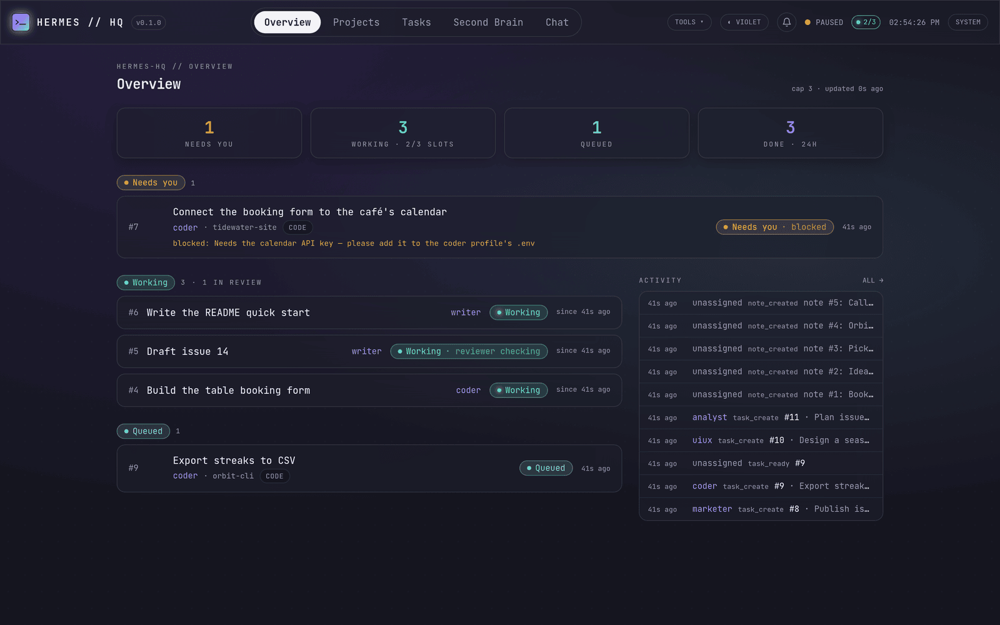
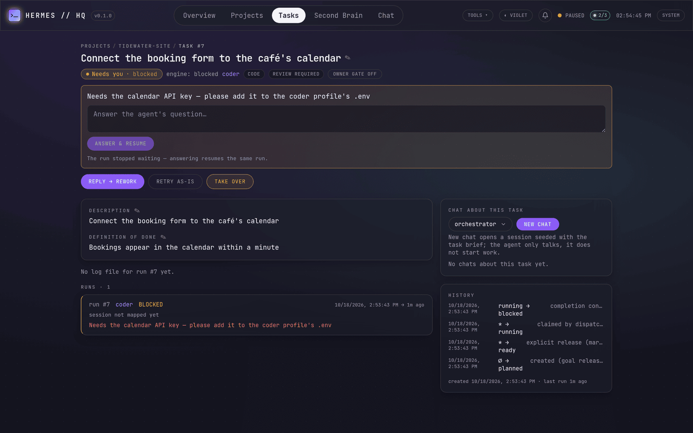
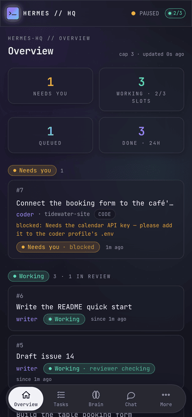
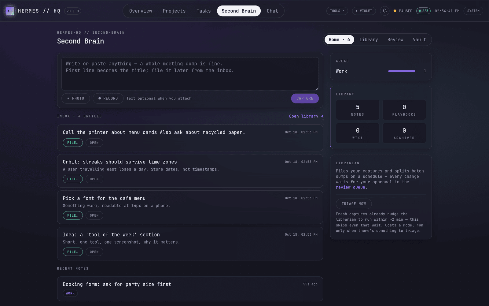

<p align="center">
  
</p>

<h1 align="center">hermes-hq</h1>

<p align="center">
  <b>A control plane for a <a href="https://github.com/NousResearch/hermes-agent">Hermes Agent</a> team.</b><br>
  Projects become tasks, every task runs as a real agent session, and a reviewer checks the work before it counts.<br>
  You get one page that says what is working, what is done, and the one thing that needs you.
</p>

<p align="center">
  <a href="https://github.com/smkamranqadri/hermes-hq/actions/workflows/test.yml"></a>
  <a href="LICENSE"></a>
  
  
  
</p>

Running several Hermes profiles as a team (an orchestrator plus an analyst, a writer, a coder, a
reviewer and so on) works well until you try to coordinate them from chat windows. Sessions get
lost when something crashes, nobody knows which task is stuck, and "done" means whatever the agent
said it means.

hermes-hq sits on the same server as Hermes. It keeps the work in a small SQLite store, hands each
task to the right agent as its own Hermes session, holds the result until a reviewer approves it,
and shows the whole team on one screen. When an agent is blocked, the question lands in your
"Needs you" list; you answer it, and the same run carries on.

<p align="center">
  
</p>

## How to use

### Requirements

- A Linux server (or VM) where [Hermes Agent](https://github.com/NousResearch/hermes-agent) is
  installed and `hermes` is on `PATH`, with at least one model configured.
- Python 3.11 or newer and [`uv`](https://github.com/astral-sh/uv).
- Node 22 or newer (to build the web UI).

hermes-hq stores no API keys. Models and providers stay configured in Hermes.

### Install

```bash
git clone https://github.com/smkamranqadri/hermes-hq.git && cd hermes-hq
bash install.sh
```

`install.sh` creates a virtualenv, builds the UI and installs a supervised service (systemd or
s6, whichever it finds). It is safe to run again. Useful flags:
`--no-service` to skip the service, `--host` / `--port` (default `0.0.0.0:9010`) and `--interval`
(dispatcher tick in seconds).

Open `http://<server>:9010` and log in. On first start the server generates a password, prints it
once to its log and saves it at `$HERMES_HOME/hermes-hq/password`; set `HERMES_HQ_PASSWORD` to
choose your own.

> [!IMPORTANT]
> hermes-hq can run shell commands and agents on your server, so treat its login like SSH access.
> Keep it on a private network (a VPN such as Tailscale, or localhost) and put HTTPS in front of
> it. See [Security](#security).

### First steps

1. **Add your agents.** Under *Agents*, install the orchestrator and specialists from the bundled
   templates in [`agents/`](agents/). Each one becomes a normal Hermes profile.
2. **Create a project.** A project points at a folder (a git repo for code work).
3. **Add tasks, or ask the orchestrator.** Give each task a definition of done, an assignee and a
   review policy. Or describe the goal in *Chat* and let the orchestrator interview you and plan it.
4. **Watch the overview.** The dispatcher claims ready tasks, runs them as real Hermes sessions (code
   tasks get their own git worktree), and sends finished work to the reviewer.
5. **Unblock.** Anything under *Needs you* has one action: answer the question, approve the plan,
   accept the result, or send it back with feedback.

The full idea-to-shipped path is in [docs/workflow.md](docs/workflow.md).

<table>
  <tr>
    <td width="68%"></td>
    <td></td>
  </tr>
  <tr>
    <td>A blocked task shows the agent's question. Answering resumes the same run.</td>
    <td>The whole UI works on a phone and installs as a web app.</td>
  </tr>
</table>

### Day-to-day commands

```bash
hermes-hq service status | restart | uninstall
hermes-hq service update                   # git pull, rebuild what changed, restart, health check
hermes-hq service auto-update --show       # daily at 05:00 by default; --cron '…' or --off
hermes-hq wm status                        # the engine CLI: tasks, reviews, backups, checks
hermes-hq wm backup                        # online SQLite backup
```

If an update breaks the server, roll back with `git reset --hard @{1} && hermes-hq service restart`.

### Configuration

Everything has a default; these environment variables change it.

| Variable | Default | What it does |
| --- | --- | --- |
| `HERMES_HOME` | `~/.hermes` | Where Hermes lives; hermes-hq keeps its state in `$HERMES_HOME/hermes-hq/` |
| `HERMES_HQ_HOME` | `$HERMES_HOME/hermes-hq` | Override the state directory (`hq.db`, run logs, password) |
| `HERMES_HQ_PASSWORD` | generated | Login password (otherwise read from the password file) |
| `HERMES_HQ_TZ` | `UTC` | Time zone for schedules, reminders and the daily auto-update |
| `HERMES_HQ_PUSH_CONTACT` | `hermes-hq@example.com` | Contact address sent to Web Push services |

### Notifications and Web Push

Notifications (tasks that need you, finished work, chat replies, agent questions) show in the bell
on desktop and the Inbox tab on phones. Browser alerts work while the tab is in the background.
Push alerts while the app is closed need the app served over **HTTPS** (for example
`tailscale serve --bg --https=443 http://localhost:9010`, or any reverse proxy with a
certificate); on iPhone, add it to the Home Screen first, then turn on *Push to this device* in
the Inbox. The VAPID key pair is generated on first use and kept in the state directory.

## What you get

- **Real sessions, not a kanban.** Every task run is a persistent Hermes session you can open,
  read and resume. Code tasks run in their own git worktree, and an approved result lands on `main`
  by itself.
- **A reviewer gate.** Tasks with a review policy are not done until the reviewer agent approves
  them. "Changes requested" sends the task back with the reviewer's notes.
- **Status you can read.** The engine has eleven precise states; the UI folds them into five, plus
  a one-line reason:

  | You see | Engine states |
  | --- | --- |
  | **Backlog** | planned, draft |
  | **Queued** | ready, waiting on another task, rework |
  | **Working** | running, needs_review ("reviewer checking") |
  | **Needs you** | waiting for approval, blocked, failed, stalled, each with the action that unblocks it |
  | **Done** | done, manual |

- **Owner gates.** Mark a task as needing your approval before it starts, and integration steps
  such as deploys stay yours.
- **Second Brain.** Capture text, photos and voice notes from your phone. A librarian agent
  proposes how to file, split or link them, and nothing changes until you approve. A private vault,
  sealed with its own passphrase, keeps chosen notes away from every agent.
- **The rest of the toolbox.** Direct chat with any agent, schedules and reminders, a web terminal,
  file browser, and views of each agent's memory, skills and MCP servers.

<p align="center">
  
</p>

## Contributing

Contributions are welcome. The most useful help right now:

- Install it next to your own Hermes team and
  [open an issue](https://github.com/smkamranqadri/hermes-hq/issues) for anything that confused
  or broke.
- Fix a bug, with a test that fails before your change.
- Improve the agent templates in [`agents/`](agents/), or the docs.

Read [CONTRIBUTING.md](CONTRIBUTING.md) before your first pull request. It covers the dev setup,
the test suite and how the project is laid out.

```bash
uv venv .venv && uv pip install --python .venv/bin/python -e . pytest httpx
(cd frontend && npm ci && npm run build)        # builds the UI into backend/static
.venv/bin/hermes-hq serve --no-dispatcher       # UI and API only; never launches agents
.venv/bin/python -m pytest tests/backend -q     # the test suite
```

## Security

hermes-hq is built for **one owner on a private network**. Please read the
[threat model and known limits](SECURITY.md) before you expose it anywhere. In short: one password
guards everything, including a web terminal and agents that can run commands, so keep it behind a
VPN and HTTPS and use a long generated password.

Report security problems privately through
[GitHub security advisories](https://github.com/smkamranqadri/hermes-hq/security/advisories/new),
not in a public issue.

## Project layout

```text
core/        the engine: SQLite store, dispatcher, run wrapper, wm CLI (no web dependencies)
backend/     FastAPI service, hermes-hq CLI, in-process dispatcher, Second Brain, vault
frontend/    Vite + React 19 + Tailwind 4, built into backend/static
agents/      templates for the orchestrator and specialist Hermes profiles
tests/       backend (pytest) and engine suites
docs/        the workflow guide and README images
kis/         the project's own memory: decisions, plans and current state, written while it was built
```

## Credits

- Visual language and theme palettes: [outsourc-e/hermes-workspace](https://github.com/outsourc-e/hermes-workspace) (MIT).
- Supervisor patterns (durable queue, event stream): [jpalmae/hermeshq](https://github.com/jpalmae/hermeshq) (MIT).
- Built on [Hermes Agent](https://github.com/NousResearch/hermes-agent) by Nous Research.

## License

[MIT](LICENSE)
